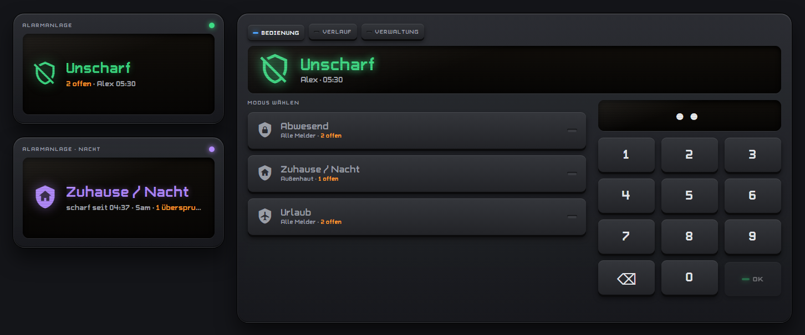
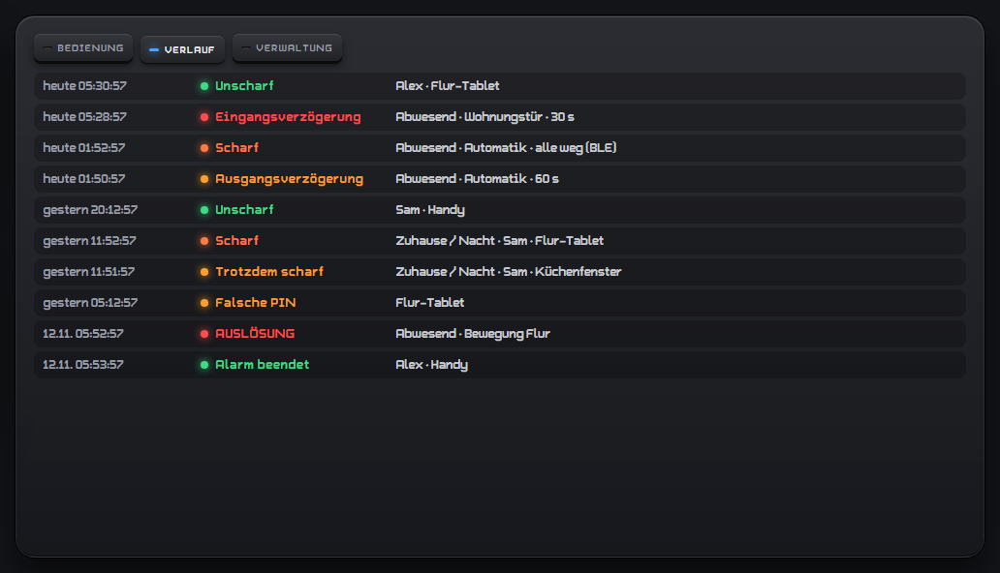

# Alarm System

A self-contained alarm system for Home Assistant: one `alarm_control_panel` with the modes **Away**, **Home / Night** and **Vacation**, a PIN per person, sensors per mode, entry/exit delays, a history log, notification channels and optional automation (presence / BLE, door lock, "only arm when closed").


*Companion card [Home Twin Alarm Card](https://github.com/SysriX/home_twin_alarm_ha_card): tiles for disarmed / armed (home) and the control popup with mode selection and PIN pad (UI in German)*


*History tab of the control popup (UI in German)*

Integration domain: `alarm_system`  
Version: 1.2.0  
UI language of the built-in texts (states, history, notifications): German

> Built for the author's own home. Defaults are generic, but you will want to review sensors, delays, texts and channels after the first start.

## Features

- **State machine**: disarmed → arming (exit delay) → armed (away / home / vacation) → pending (entry delay) → triggered. After the alarm duration it returns to armed (or disarmed, configurable). The armed state survives a Home Assistant restart.
- **Sensors per mode**: every `binary_sensor` (door, window, motion, presence, smoke, water, tamper, …) can be assigned to modes, marked as *delayed* (entry delay) or *24 h* (always triggers, even when disarmed). HA groups can be used as one sensor – their members inherit the settings.
- **Open sensors on arming**: either bypass or block (`service_open`). Per mode you can allow a bypassed sensor to close (e.g. a window moved by the wind); after a settle time it is monitored normally again.
- **Persons and PINs**: each person has a salted SHA-256 hashed PIN (4–8 digits), optionally linked to a `person` entity, and can be granted admin rights for the settings. Wrong PINs are counted and lock the input for a while. Home Assistant admins can always change settings.
- **Automation** (all off by default):
  - *Presence*: arm when all selected persons / device trackers / BLE trackers are away (with delay), disarm when someone returns.
  - *Lock*: arm when a lock is locked, disarm when it is unlocked (optionally only when everyone is away).
  - *Closed*: arm only when the selected doors/windows are closed.
- **Notification channels** with per-event selection (pending, triggered, armed, disarmed, wrong PIN, automation blocked) and editable text templates:
  - `tablet` – full-screen popup on wall tablets via [Browser Mod](https://github.com/thomasloven/hass-browser_mod) (`custom:home-twin-alarm-popup`)
  - `push`, `email`, `sms`, `phone`, `imessage` – any HA service (e.g. `notify.mobile_app_…`) with a data template
  - `siren` – turns sirens / switches on while triggered
  - `rest` – HTTP request to any URL
- **History**: the last 300 events are stored, the last 25 are exposed as an attribute. Every history entry also fires the event `alarm_system_event` for your own automations.

## Entities

| Entity | Description |
| --- | --- |
| `alarm_control_panel.home_security_system` | The alarm panel (arm away / home / vacation, disarm, trigger) |
| `switch.home_security_system_cfg_auto_presence` | Automation: presence |
| `switch.home_security_system_cfg_auto_lock` | Automation: door lock |
| `switch.home_security_system_cfg_require_closed` | Only arm when closed |
| `switch.home_security_system_cfg_allow_close_away` / `_home` / `_vacation` | Allow bypassed sensors to close, per mode |
| `binary_sensor.home_security_system_presence` | Someone present (according to the presence automation entities) |
| `binary_sensor.home_security_system_openings` | Doors/windows of the "closed" rule open |

## Services

| Service | Description |
| --- | --- |
| `alarm_system.arm` | Arm (`mode`, optional `code`, `force` to bypass open sensors, `source` for the history). Returns `ok`, `open`, `bypassed`. |
| `alarm_system.disarm` | Disarm with a PIN (`code`, optional `source`). |
| `alarm_system.check` | Returns the open or unavailable sensors of a `mode` (response only). |

The standard `alarm_control_panel.*` services work as well. A WebSocket API (`alarm_system/config`, `arm`, `disarm`, `verify`, `save`, `history`, `test_channel`) is used by the companion card.

## Requirements

- Home Assistant 2024.11 or newer
- Optional: [Browser Mod](https://github.com/thomasloven/hass-browser_mod) for the tablet popup channel
- Recommended: the companion card for configuration (there is no config flow / options UI)

## Installation

### HACS (custom repository)

1. HACS → three-dot menu → **Custom repositories**
2. Repository `https://github.com/SysriX/alarm_system_ha_integration`, category **Integration**
3. Install **Alarm System** and restart Home Assistant

### Manual

Copy `custom_components/alarm_system` into `<config>/custom_components/` and restart Home Assistant.

## Configuration

Add the integration to `configuration.yaml` (YAML only, no config flow) and restart:

```yaml
alarm_system:
```

On the first start the integration pre-selects all door, window and garage door sensors (by device class) for all modes and creates all notification channels (only the tablet channel enabled). No persons or PINs are created – add them in the companion card (as a Home Assistant admin). All settings are stored in `.storage/alarm_system`.

## Companion card

[home_twin_alarm_ha_card](https://github.com/SysriX/home_twin_alarm_ha_card) – tile, keypad popup and full settings editor (sensors, modes, persons/PINs, channels, automation, history).

## License

MIT – see [LICENSE](LICENSE).
